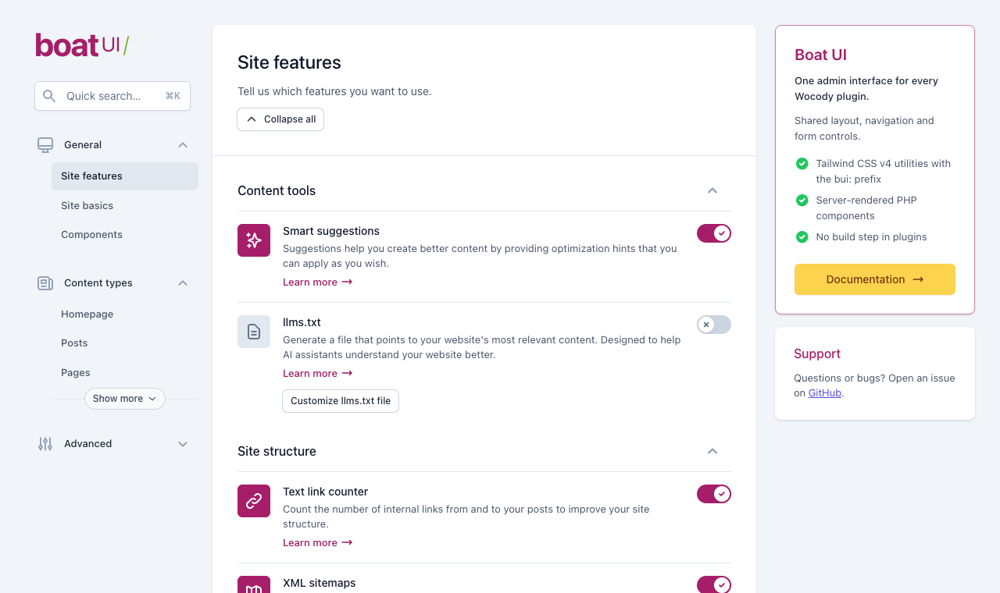

# Wocody Boat UI

Shared WordPress admin interface for every Wocody plugin (Boat Backup, SEO, Cache, …). It gives each plugin the same screen layout — brand, sidebar navigation with quick search, white settings cards, right-hand column — and the same form controls, built with **Tailwind CSS v4** and rendered by PHP.

- Server-rendered PHP components, escaped by default. No React, no build step in the plugins.
- One prebuilt stylesheet (`dist/boat-ui.css`) and one dependency-free script (`dist/boat-ui.js`).
- Scoped to `.bui-root`: WordPress admin styles outside the screen are untouched, and wp-admin CSS does not leak in.
- Safe when several plugins bundle different copies: the newest version is elected and loaded once.
- PHP 7.4+, WordPress 6.0+. English and pt_BR strings included.



## Installation

```sh
composer require wocody/wp-boat-ui
```

Load the bootstrap from the plugin's main file. Composer's autoloader does it too, but requiring the file directly keeps the plugin free of `vendor/autoload.php` at runtime:

```php
require_once __DIR__ . '/vendor/wocody/wp-boat-ui/bootstrap.php';
```

Ship these runtime paths in the plugin ZIP: `bootstrap.php`, `src/`, `dist/`, `languages/`, `LICENSE`, `NOTICE`.

## Quick start

```php
use Wocody\BoatUI\Page;
use Wocody\BoatUI\UI;

add_action( 'admin_menu', function () {
	add_menu_page( 'Boat SEO', 'Boat SEO', 'manage_options', 'boat-seo', 'boat_seo_render', 'dashicons-search' );
} );

add_action( 'admin_enqueue_scripts', function ( $hook ) {
	if ( 'toplevel_page_boat-seo' === $hook ) {
		UI::enqueue(); // Stylesheet, script and the `bui-admin-page` body class.
	}
} );

function boat_seo_render() {
	Page::render( array(
		'brand'      => array( 'name' => 'boat', 'product' => 'SEO', 'href' => '#general' ),
		'router'     => true, // One [data-bui-view] visible at a time, chosen by the URL hash.
		'navigation' => array(
			array( 'label' => 'General', 'icon' => 'desktop-computer', 'items' => array(
				array( 'label' => 'Site features', 'view' => 'general', 'active' => true ),
				array( 'label' => 'Site basics', 'view' => 'basics' ),
			) ),
			array( 'label' => 'Tools', 'icon' => 'cog', 'href' => admin_url( 'admin.php?page=boat-seo-tools' ) ),
		),
		'content'    => array(
			'<form method="post" action="options.php" data-bui-view="general">'
				. UI::paper( array(
					'as'           => 'main',
					'title'        => 'Site features',
					'description'  => 'Tell us which features you want to use.',
					'dirty_footer' => true, // The save bar appears after a change, like the reference UI.
					'content'      => UI::section( array(
						'title'   => 'Site info',
						'content' => array(
							UI::text_field( array( 'name' => 'boat_seo[name]', 'label' => 'Website name' ) ),
							UI::toggle_field( array( 'name' => 'boat_seo[tracking]', 'label' => 'Usage tracking', 'checked' => true ) ),
						),
					) ),
					'footer'       => UI::button( 'Save changes', array( 'type' => 'submit' ) ),
				) )
			. '</form>',
		),
		'aside'      => UI::aside_box( array( 'title' => 'Need help?', 'content' => '<p>Read the docs.</p>' ) ),
	) );
}
```

Text arguments are escaped. Arguments documented as *trusted HTML* (`content`, `footer`, `description`, `*_html`, …) accept a markup string, a callable that echoes or returns markup, or a list of those; escape user data before passing it.

## Components

All methods are static on `Wocody\BoatUI\UI` and return a string. Every component accepts `id`, `class` and `attrs`.

| Area | Methods |
| --- | --- |
| Layout | `Page::render()` / `Page::html()`, `paper()`, `section()`, `divider()`, `card()`, `aside_box()`, `check_list()` |
| Text | `title()`, `link()`, `code()`, `badge()`, `icon()` |
| Actions | `button()` (primary, secondary, tertiary, error, upsell; small … extra-large; `href`, `icon`, `loading`), `button_group()`, `spinner()` |
| Forms | `text_field()`, `textarea_field()`, `select_field()`, `checkbox()`, `checkbox_group()`, `radio_group()` (incl. `inline-block` tiles), `toggle()`, `toggle_field()`, `file_input()`, `disclosure()` |
| Feedback | `alert()`, `banner()`, `progress()`, `progress_field()`, `tooltip()`, `skeleton()` |
| Data | `table()` (stacks on phones, keeps header associations), `feature_group()`, `feature_list()` |
| Overlays | `modal()` (native `<dialog>`), toasts via JavaScript |

Toggles are native checkboxes with `role="switch"`, so they post like any other field. Validation is passed as `'validation' => array( 'variant' => 'error', 'message' => '…' )`. Icons are [Heroicons v1](https://v1.heroicons.com): `outline` names (`cog`) or `solid:` names (`solid:check`).

### JavaScript API

`dist/boat-ui.js` wires the components automatically. It also exposes `window.BoatUI`:

```js
BoatUI.toast({ title: 'Settings saved', description: 'Your changes are live.', variant: 'success' }); // success|error|warning|info
BoatUI.modal.open('my-modal'); BoatUI.modal.close('my-modal');
BoatUI.views.show('basics', { updateHash: true }); // when `router` is on; fires `bui:view`
BoatUI.refresh(container); // after inserting server-rendered components dynamically
```

Declarative hooks: `data-bui-modal-open="id"`, `data-bui-modal-close`, `data-bui-dismiss`, `data-bui-confirm="Are you sure?"`, and on forms `data-bui-warn-unsaved`. Dispatch `bui:saved` on a form after an AJAX save to hide its dirty footer.

## Theming

The primary scale defaults to the reference magenta (`#a61e69`). Each plugin can re-theme its screen:

```php
UI::enqueue( array( 'theme' => array(
	'primary-500' => '#0a7cbd',
	'primary-600' => '#086aa1',
	'primary-700' => '#075a88',
	'primary-300' => '#7cc0e6',
) ) );
```

Tokens are CSS custom properties named `--bui-color-{palette}-{shade}` (slate, gray, red, amber, yellow, green, blue, indigo and primary use the Tailwind v3 hex values of the reference interface).

## Tailwind utilities

Utilities use the Tailwind v4 prefix syntax and are `!important` so they win over wp-admin styles:

```html
<div class="bui:flex bui:items-center bui:gap-4 bui:md:grid-cols-2">…</div>
```

The prebuilt CSS contains the utilities used by the components plus the common set in `resources/css/safelist.txt`. Note the Tailwind v4 names: `shadow-sm` is v3's `shadow`, `rounded-sm` is v3's `rounded`. To use any other utility, build a plugin stylesheet that imports the package source and scans the plugin's templates, then enqueue it instead of the default one:

```css
/* my-plugin/assets/admin.css */
@import "../vendor/wocody/wp-boat-ui/resources/css/boat-ui.css";
@source "../includes";
```

```php
wp_deregister_style( UI::HANDLE );
wp_register_style( UI::HANDLE, plugins_url( 'assets/admin.build.css', __FILE__ ), array(), '1.0.0' );
UI::enqueue();
```

## Several plugins, one copy

Each bundled copy registers itself in `bootstrap.php`; the highest version is chosen the first time a `Wocody\BoatUI` class is used, and only that copy's classes and assets load. Keep packages within the same major version across plugins. `Wocody_Boat_UI_Loader::versions()` lists every registered copy for diagnostics.

## Showcase

Add `define( 'WOCODY_BOAT_UI_DEMO', true );` to `wp-config.php` on a development site and open **Tools → Boat UI** for every component, including a reproduction of the reference "Site features" and "Site basics" screens.

## Development

```sh
npm install
npm run build        # dist/boat-ui.css (Tailwind CLI, minified) and dist/boat-ui.js
npm run watch        # rebuild CSS on change
npm run icons        # regenerate src/icons.php from Heroicons
composer install
composer test        # dependency-free PHP smoke tests
composer standards   # WordPress Coding Standards + PHP 7.4 compatibility
```

`dist/` is committed so that plugins never need Node. Releases follow SemVer: bump the version in `bootstrap.php`, rebuild, update `CHANGELOG.md`, then tag `vX.Y.Z` and push; Packagist picks the tag up.

## License

GPL-2.0-or-later. Bundles Heroicons and compiled Tailwind CSS (both MIT); see `NOTICE`.
